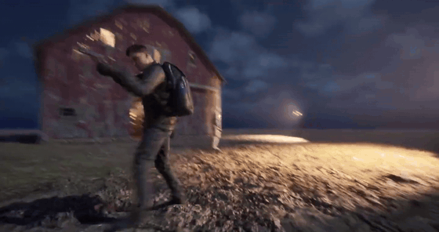

# NIGHTFALL: TACTICAL ENCOUNTER

**Third-Person Combat & Enemy AI Prototype | Unreal Engine 5**

*Blueprint gameplay · Animation Blueprints · Behaviour Trees · AI Perception · Camera-based shooting*

**[▶ Gameplay highlights (36.5 seconds)](#gameplay-footage)** · [Screenshots](#selected-gameplay-screenshots) · [Technical systems](#gameplay-and-technical-systems)

## About the project

**Nightfall: Tactical Encounter** is a personal gameplay systems prototype developed in Unreal Engine 5. The player explores a nighttime barn environment, aims a pistol in third person, and encounters enemy AI that patrols the area and pursues the player when detected. Camera-based line traces register shots, apply damage, and allow enemies to be eliminated.

The goal was to **learn and integrate gameplay systems using Blueprints**: character animation, AI behavior, hit detection, aiming, and UI. The character and environment art come from third-party assets; my work focuses on gameplay logic, implementation, integration, and testing.

This is a **technical portfolio showcase**, not a downloadable, complete Unreal Engine project. The local project was developed under the working title `Animation_Prototype`.

## Gameplay footage

https://github.com/user-attachments/assets/da274885-5e39-4f14-bd76-713b6dec4da6

**Animated preview (5 seconds, muted):**

**Full gameplay video (36.5 seconds, with audio):**

<!-- IMPORTANT: Paste the URL created by GitHub when you upload the compressed MP4 in its editor here, alone on its own line. It should begin with https://github.com/user-attachments/assets/ . Do not wrap it in Markdown link syntax. -->

**[▶ Open or download the MP4](media/nightfall-gameplay-highlights.mp4)**

The video includes exploration, enemy encounters, movement, aiming, shooting, and traversal through the barn. The animated preview plays without sound; the full MP4 includes audio.

## Gameplay and technical systems

| Area | Implementation |
| --- | --- |
| **Animation** | Idle/walk/run Blend Space, jump state, montages, animation notifies, Aim Offset, and upper-body layered blends |
| **Player character** | Third-person controls, human survival-character Skeletal Mesh, and integration with existing animation systems |
| **Enemy AI** | AI Controller, Behaviour Tree, Blackboard, AI Perception, navigation, random patrol locations, and player pursuit |
| **Combat** | Pistol attachment, camera-based line tracing, hit detection, `Apply Damage`, enemy health, and elimination |
| **Aiming and UI** | Right-mouse ADS, Timeline-driven camera transitions, Spring Arm interpolation, and an on-screen crosshair |
| **Audio** | MetaSound pistol firing effect with pitch variation |
| **Blueprint communication** | Event Dispatchers for gameplay interactions and training targets |
| **Environment integration** | Ready-made barn environment adapted into a playable combat and AI test level |

## Selected gameplay screenshots

| Enemy encounter | Barn interior |
| --- | --- |
|  |  |

## Key Blueprint assets

- `BP_ThirdPersonCharacter` — player movement, aiming, camera trace, and damage application
- `ABP_Lab_Basico` — animation state logic and layered character animation
- `BP_EnemyCharacter` — enemy health, damage response, and elimination
- `BP_EnemyAIController`, `BT_Enemy`, `BB_Enemy` — AI perception and behavior decisions
- `BTT_FindPatrolLocation` — randomly selected navigable patrol targets
- `TL_CameraAim` — smooth aim camera transitions
- `WBP_Crosshair` — aiming reticle widget
- `MSS_Pistol_Fire` — gunshot MetaSound

## Technology and scope

- **Engine:** Unreal Engine 5.8.3 (local development)
- **Implementation:** Blueprints; no custom C++ in this prototype
- **Platform:** Windows desktop; locally tested in Unreal Editor
- **Status:** Playable learning prototype and portfolio showcase, not a commercial release

## Third-party assets and licensing

The barn environment, survival character, and some audiovisual assets were created by third-party artists and remain subject to their respective licenses. My contribution is the Blueprint implementation, integration, and gameplay logic described above.

To respect third-party licenses, this public repository intentionally does **not** redistribute those packages, meshes, textures, animations, sounds, or other licensed `.uasset` files. The repository contains portfolio documentation and gameplay media rather than a full Unreal Engine project.

## Developer

- **Portfolio:** https://lucashoelzle.pages.dev/
- **GitHub:** https://github.com/lukyi124
- **LinkedIn:** https://www.linkedin.com/in/lucas-hoelzle-891b10145/
